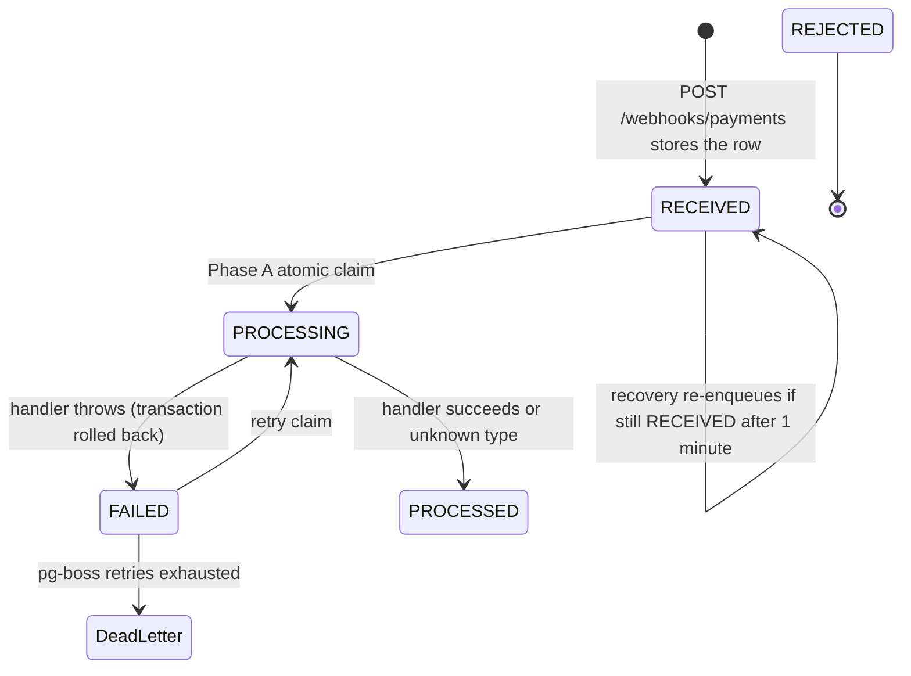

# Background jobs

Webhook events are stored first (see [webhooks.md](webhooks.md)), then processed asynchronously by a separate **worker** process. The queue is [pg-boss](https://github.com/timgit/pg-boss) **10.4.2**, which stores jobs in PostgreSQL. There is no Redis.

The backend Dockerfile uses Node 20, so this project cannot use pg-boss 11+ (those require Node 22).

## Why pg-boss

BillingHub already runs Postgres. pg-boss uses the same database, creates its own `pgboss` schema, and gives retries, a dead-letter queue, unique jobs, and cron without another piece of infrastructure.

## Queue names

Defined in `backend/src/jobs/queues.ts`:

| Queue | Role |
| --- | --- |
| `process-webhook-event` | Process one `webhook_events` row. Job data is `{ webhookEventId }` only — never the payload. |
| `webhook-events-dead-letter` | Copy of a job after retries are exhausted. The worker only logs an error. |
| `webhook-event-recovery` | Cron every minute. Re-enqueues `RECEIVED` rows older than one minute (max 100). |

`process-webhook-event` uses pg-boss 10 **stately** policy plus `singletonKey = webhookEventId`. v10 has no `exclusive` policy; stately allows one job per state (created / retry / active) per event id, so the same event is not queued twice at the same time.

## Event lifecycle



`REJECTED` rows (bad signature or payload) are never enqueued.

## Two-phase processor

`createWebhookProcessor(registry)` returns `processWebhookEvent(id)`. It does not call pg-boss, so tests can invoke it directly.

1. **Advisory lock** (dedicated `pg` connection, held for the whole call): `pg_try_advisory_lock(hashtext('webhook_event'), hashtext(id))`. A second invocation returns immediately without incrementing `attempts`. PostgreSQL releases the lock if the connection dies, so a crashed worker can be retried. There is no time-based reclaim, so a live handler cannot be stolen.
2. **Phase A** (short transaction, committed immediately): if `PROCESSED` / `REJECTED`, return. If `RECEIVED` / `FAILED`, set `PROCESSING` and increment `attempts`. If `PROCESSING` while holding the advisory lock, reclaim without incrementing (abandoned after a crash, not an in-flight handler).
3. **Phase B** (one interactive `prisma.$transaction`): lock the row with `SELECT ... FOR UPDATE`, re-check status, run the handler **inside** the transaction, then set `PROCESSED`, `processedAt`, and `lastError = null`. If the handler throws, the transaction rolls back (no business writes are kept). A follow-up update sets `FAILED` and `lastError` (truncated to 2,000 characters, no stack, no payload), then the error is re-thrown so pg-boss retries.

Unknown event types are marked `PROCESSED` with `lastError = "No handler registered for type X"` so they do not retry forever.

## Handlers and `ctx.tx`

Handler signature:

```ts
(ctx: { event: WebhookEvent; tx: Prisma.TransactionClient; logger: Logger }) => Promise<void>
```

Steps 9–12 must write all business rows through `ctx.tx` so those writes commit together with `PROCESSED`. A thrown handler rolls everything back.

### Adding a handler

1. Create a file under `backend/src/jobs/handlers/` (for example `paymentSucceeded.ts`).
2. Export a function that uses `ctx.tx` only for database writes.
3. Register it, replacing the stub:

```ts
import { registerHandler } from './index';

registerHandler('payment.succeeded', async ({ event, tx, logger }) => {
  // TODO(Step 9): create Payment / activate subscription via tx
  logger.info({ eventId: event.id, type: event.type }, 'payment.succeeded');
});
```

4. Keep the stub TODO comment until the real step lands. Do not log payloads, signatures, or secrets.

In development and test (`NODE_ENV !== "production"`) two extra types exist: `debug.ok` (succeeds) and `debug.fail` (always throws `Error("debug failure")`).

## Retry settings

Configured on the queue and on each `send()`:

- `retryLimit`: `WEBHOOK_JOB_RETRY_LIMIT` (default **5**). In pg-boss 10 this is the number of **extra retries** after the first run (`retry_count < retry_limit`).
- `retryDelay`: 10 seconds
- `retryBackoff`: true
- `deadLetter`: `webhook-events-dead-letter`

Counts to keep separate:

| Counter | What it means |
| --- | --- |
| Handler executions | Times `processWebhookEvent` actually claimed the row (Phase A) |
| `webhook_events.attempts` | Same as handler executions |
| pg-boss `retry_count` | Incremented on fetch after the first run |
| pg-boss `retryLimit` | Extra retries, not total runs |

With `retryLimit = 5`, a job that always fails runs **6** times (`attempts = 6`), then is copied to the dead-letter queue. The `webhook_events` row stays `FAILED`.

Tests pass a short `retryDelay` (and `retryBackoff: false`) so they do not wait 10 seconds.

## Recovery job

Every minute the worker schedules `webhook-event-recovery`. `recoverStuckWebhookEvents()` (exported for tests) finds `RECEIVED` rows with `receivedAt` older than 1 minute, up to 100, and calls `enqueueWebhookEvent`. The unique job key prevents duplicates. It logs only when `requeued > 0`.

Stale `PROCESSING` after a crash is reclaimed only after the advisory lock is available again (the crashed connection is gone). Recovery does not re-enqueue `PROCESSING` rows and does not use a timeout, so it cannot race a live Phase B.

## How to run the worker

```bash
docker compose up --build
docker compose logs -f worker
```

Startup logs registered handler types and the three queue names. The Compose command is `npm run worker:dev` (`tsx watch src/worker.ts`). Production: `npm run build` then `npm run worker` (`node dist/worker.js`).

The API process starts pg-boss in send-only mode (`supervise: false`, `schedule: false`). Only the worker runs maintenance and cron.

## Safe restart

The Postgres volume is external (`saas-billing-portal_postgres_data`). Do **not** run `docker compose down -v`. That deletes billing data.

```bash
docker compose restart worker
docker compose up -d --build worker
docker compose restart backend worker
```

Full stack without deleting the volume: `docker compose down` then `docker compose up --build`.

pg-boss tables live in schema `pgboss` on the same database Prisma uses. `prisma migrate deploy` only applies Prisma migrations and does not drop that schema.

## Tests

Queue integration tests use database `billinghub_test` and schema `pgboss_test` so they cannot share jobs with the development worker (`billinghub` / `pgboss`). They do not drop or truncate application tables. pg-boss instances are stopped in `afterAll`.
