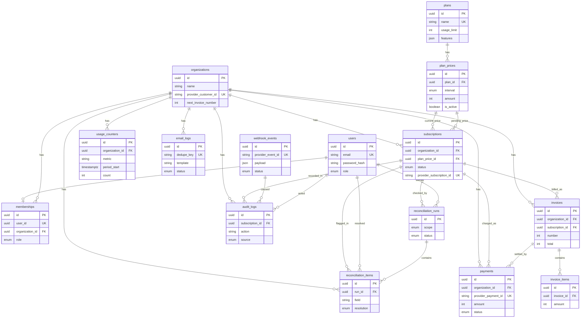

# Database schema

Core Postgres schema owned by the backend Prisma project (`backend/prisma/schema.prisma`). Money is always integer minor units plus a 3-letter currency code. The payment simulator has its own data in a later step. pg-boss (Step 8) creates a separate schema and is not modelled here.

## Entity relationship diagram

## Tables and later steps

| Table | Purpose | Later step |
| --- | --- | --- |
| `users` | Login accounts (customer or admin) | Step 3 auth |
| `organizations` | Billing customer / tenant | Step 4 onboarding |
| `memberships` | User belongs to one org (unique on `user_id`; can be relaxed later) | Step 4 |
| `plans` | Catalog of products and usage limits | Step 5 (this step) |
| `plan_prices` | Versioned MONTH/YEAR prices in minor units | Step 5 (this step) |
| `subscriptions` | Org's current (or historical canceled) plan | Step 7 subscribe |
| `invoices` | Sequential per-org invoices | Step 10 invoicing |
| `invoice_items` | Line items; cascade-deleted with invoice | Step 10 |
| `payments` | Provider payment attempts; idempotent on `provider_payment_id` | Step 9 webhooks |
| `usage_counters` | API-call counts per org/metric/period | Step 12 usage |
| `webhook_events` | Raw provider events and processing state | Step 9 webhooks |
| `audit_logs` | Append-only subscription history (no `updated_at`) | Step 17 audit |
| `email_logs` | Outbound mail with `dedupe_key` | Step 8 worker / email |
| `reconciliation_runs` | Operator-triggered simulator vs local checks | Step 16 reconcile |
| `reconciliation_items` | One mismatch row per field | Step 16 reconcile |

## Key constraints

- **Webhook idempotency:** `webhook_events.provider_event_id` is unique. Invalid signatures store `NULL` (Postgres unique allows many NULLs) plus `raw_body`.
- **Payment / invoice idempotency:** `payments.provider_payment_id` is unique so the same provider payment cannot create a second payment or invoice.
- **One active price per plan + interval:** partial unique index `plan_prices (plan_id, interval) WHERE is_active = true`. Editing a price inserts a new row and retires the old one (Step 5).
- **One non-canceled subscription per organization:** partial unique index `subscriptions (organization_id) WHERE status <> 'CANCELED'`.
- **Usage uniqueness:** `usage_counters` unique on `(organization_id, metric, period_start)`.
- **Money:** integer minor units (`Int`) plus a 3-letter `currency` (default `USD`). Never Float or Decimal.
- **Invoice numbers:** unique `(organization_id, number)`; `organizations.next_invoice_number` is the sequence source (Step 10).
