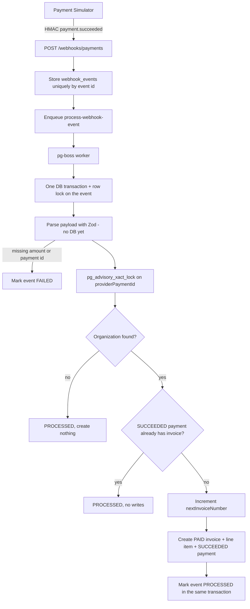

# Invoices and payment history

When a verified `payment.succeeded` webhook is processed, BillingHub creates **one invoice** (with one line item) and **one payment** for that provider payment id. Customers can then list invoices, open a detail page, download a PDF, and see payment history — including failed first payments from checkout.

This step does not send email, compute upgrades, retry renewals, refund, tax, or coupons.

## How an invoice is created

`payment.succeeded` never changes subscription status. `subscription.activated` still owns `PENDING` → `ACTIVE`. The invoice handler works whether it runs before or after activation (the subscription may still be `PENDING`).

Linking uses simulator fields, in order: `data.metadata.subscriptionId`, then `data.subscriptionId` (provider), then `data.metadata.organizationId` / `data.customerId` for the organization only. If the organization is found but the subscription is not, the invoice and payment are stored with `subscriptionId` null.

## Idempotency

Three layers keep one charge as one invoice and one payment:

1. **Webhook row.** The same simulator event `id` is stored once. Extra deliveries increment `duplicateCount` and do not insert a second `webhook_events` row.
2. **Advisory lock.** After Zod validation, the handler’s first database call is `SELECT pg_advisory_xact_lock(hashtextextended(providerPaymentId, 0))`. Two workers (or two different event ids that share a payment id) cannot interleave. The lock is released when the transaction ends.
3. **Same transaction as PROCESSED.** The invoice, line item, payment, invoice number increment, and the event’s `PROCESSED` mark commit together. A thrown handler rolls all of that back.

The unique constraint on `payments.providerPaymentId` and the unique `(organizationId, number)` on invoices are the final safety net. An existing `FAILED` or `PENDING` payment with that provider id is **updated in place** (same row id) to `SUCCEEDED` and attached to the new invoice. A `SUCCEEDED` payment that already has an `invoiceId` is a no-op.

## Invoice numbering

Numbers are per organization. `allocateInvoiceNumber` increments `organizations.nextInvoiceNumber` with Prisma `{ increment: 1 }` and uses `returned value - 1`. Because that update runs inside the handler transaction, a rollback also rolls back the increment: **no gaps and no duplicates**. The database stores the integer; APIs return both `number` and `displayNumber` (`INV-` plus six digits, for example `INV-000001`).

## Endpoints

All customer routes use the session cookie and `requireOrganization`. OWNER and MEMBER may read. Organization is taken from `req.organization.id`, never from the client. Provider ids are never returned.

| Method | Path | Auth | Response |
| --- | --- | --- | --- |
| GET | `/invoices?page=1&pageSize=10` | Cookie + organization | Paginated list, newest `issuedAt` then `number`. `pageSize` default 10, max 50 |
| GET | `/invoices/:id` | Cookie + organization | Detail with line items, billed-to block, and payment. Malformed id = 400. Missing or another org = 404 |
| GET | `/invoices/:id/pdf` | Cookie + organization | `application/pdf` attachment `invoice-INV-000001.pdf`. Same 404 rule |
| GET | `/payments?page=1&pageSize=10` | Cookie + organization | Paginated history including `FAILED` rows, newest `createdAt` |

Unauthenticated requests are 401. An admin with no organization is 403.

## PDF contents

Generated on the fly with pdfkit (Helvetica only):

- Header **BillingHub**
- Notice **SIMULATED PAYMENT - no real money was charged**
- **INVOICE INV-000001**, status, issue date, paid date, billing period
- **Billed to** organization name and billing email
- Line-item table (description, quantity, unit amount, amount)
- Subtotal and total via `formatMoney` (`USD 29.00`, currency **code**, not symbols)
- Footer payment method label when present

## Intentionally missing

Tax, refunds, credit notes, coupons, email receipts, upgrade/downgrade proration, renewal retries, admin invoice views, and the billing overview page.
