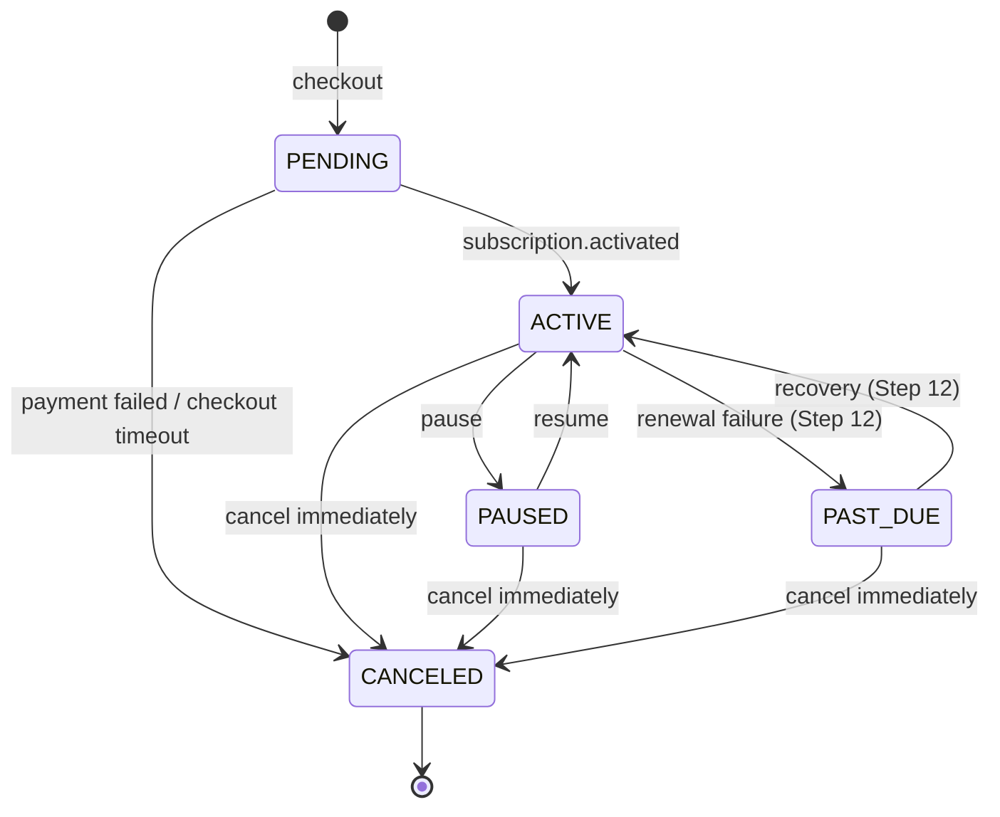

# Subscription changes

Organization owners can upgrade, downgrade, pause, resume, and cancel the current subscription. Money, plans, and period dates always come from the database. Clients send only a plan price id or a cancel choice.

Scheduled downgrades and period-end cancellations are stored here. The job that applies them at renewal is Step 12.

## Status transitions

`PENDING` is owned by checkout. Pause, plan change, and cancel-at-period-end are not available until the subscription is `ACTIVE`. Cancel at period end keeps status `ACTIVE` until Step 12 ends it.

## Operations

| Endpoint | Who | Allowed states | Provider call | Local effect | Audit action |
| --- | --- | --- | --- | --- | --- |
| `GET /subscriptions/current/change-preview` | OWNER | ACTIVE, no scheduled cancel | No | None (estimate only) | — |
| `POST /subscriptions/current/change-plan` upgrade | OWNER | ACTIVE, no scheduled cancel | `changeSubscriptionPlan` with prorated `chargeAmount` and key `sub-upgrade-<id>-<toPriceId>-<periodEndEpoch>` | `planPriceId` = target, clear pending, **period dates unchanged** | `subscription.upgraded` |
| `POST /subscriptions/current/change-plan` downgrade | OWNER | ACTIVE, no scheduled cancel | No | `pendingPlanPriceId` = target | `subscription.downgrade_scheduled` |
| `DELETE /subscriptions/current/scheduled-change` | OWNER | pending change set | No | clear `pendingPlanPriceId` | `subscription.scheduled_change_canceled` |
| `POST /subscriptions/current/pause` | OWNER | ACTIVE, no scheduled cancel | `pauseSubscription` | `PAUSED`, `pausedAt` | `subscription.paused` |
| `POST /subscriptions/current/resume` | OWNER | PAUSED | `resumeSubscription` with computed period end | `ACTIVE`, clear `pausedAt`, extend `currentPeriodEnd` | `subscription.resumed` |
| `POST /subscriptions/current/cancel` `AT_PERIOD_END` | OWNER | ACTIVE | `setCancelAtPeriodEnd(true)` | flag true, clear pending, status stays ACTIVE | `subscription.cancel_scheduled` |
| `POST /subscriptions/current/cancel` `IMMEDIATELY` | OWNER | ACTIVE, PAST_DUE, PAUSED | `cancelSubscriptionNow` | `CANCELED`, `canceledAt`/`endedAt` | `subscription.canceled` |
| `POST /subscriptions/current/undo-cancel` | OWNER | ACTIVE + scheduled cancel | `setCancelAtPeriodEnd(false)` | flag false | `subscription.cancel_undone` |

MEMBER users can read `GET /subscriptions/current`. They cannot call the mutating endpoints.

## Proration (upgrades only)

`remainingMs = clamp(periodEnd - now, 0, totalMs)`

`creditAmount = round_half_up(oldAmount * remainingMs / totalMs)`

`newPeriodAmount = round_half_up(newAmount * remainingMs / totalMs)`

`chargeAmount = max(0, newPeriodAmount - creditAmount)`

Multiplication and division use BigInt. There are no refunds: a cheaper plan is scheduled, not credited.

Worked example: period 1 Jan 2026–1 Feb 2026 (31 days), now 16 Jan 2026, Starter 900 → Pro 2900. Remaining 16 days. Credit 465, new-period amount 1497, charge **1032**.

A zero charge (last instant of the period) still applies the new plan and tells the provider to charge nothing, so no payment or invoice is created.

## Operation pattern

Each mutation runs in one 20-second interactive transaction:

1. Lock the organization's current non-canceled subscription (`SELECT ... FOR UPDATE`).
2. Re-check the state rules.
3. Call the provider **while still holding the row lock** so a second request waits instead of charging twice.
4. Write local columns and an audit row, then commit.

If the provider rejects the call, the transaction rolls back (402 `PAYMENT_REJECTED` or 502 `PAYMENT_PROVIDER_UNAVAILABLE`) and no audit row remains. If the provider succeeds and the local commit then fails, BillingHub logs the subscription id and operation and returns 500. It does **not** retry with a new idempotency key. Step 18 reconciliation will see the difference.

## Webhooks confirm only

`subscription.updated` (including pause/resume) does not change plan, status, period, or flags. It may fill an empty `providerSubscriptionId`.

`subscription.cancelled` (British spelling from the simulator) acts only when the event `status` says the subscription has ended (`canceled`). Cancel-at-period-end emits `subscription.updated` on the simulator and does not end the BillingHub row. If the local row is already `CANCELED`, the handler is a no-op.

Upgrade invoices are created by the existing `payment.succeeded` handler. When the event metadata includes a description, that text is the invoice line item, even if the event is processed before the upgrade transaction commits.

## Limitations

- Monthly and yearly cannot be mixed on a plan change.
- No refunds or credits carried to a later invoice.
- Scheduled downgrades and period-end cancellations are applied by the renewal job in Step 12.
- The payment provider is the labelled simulator. It never moves real money.
