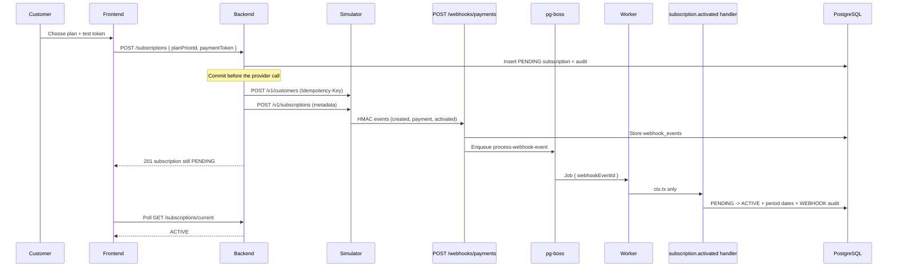

# Subscription creation and checkout

A customer (organization OWNER) chooses a plan price and a **simulator test token**. BillingHub creates a local `PENDING` subscription first, then calls the Payment Simulator. The subscription becomes `ACTIVE` only after the worker processes a verified `subscription.activated` webhook. The checkout HTTP request never sets `ACTIVE`.

## Flow

## Status rules (this step)

| Status | How it is reached | Notes |
| --- | --- | --- |
| `PENDING` | `POST /subscriptions` after a successful local insert | Written **before** the simulator call so a fast webhook can find the row |
| `ACTIVE` | Worker processes `subscription.activated` while the row is still `PENDING` | Never set from the checkout API, from `subscription.created`, or from `payment.succeeded` |
| `CANCELED` | Provider reject/unavailable at call time, pending timeout, or first-payment `payment.declined` / `payment.insufficient_funds` | Customer can start checkout again |

**Never activate without a processed webhook.** `subscription.created` fires before the first charge. `payment.succeeded` stays a stub until Step 10. A late `subscription.activated` for `CANCELED`, `PAST_DUE`, or `PAUSED` is ignored.

## Failed and abandoned checkout

- **Call-time reject** (`ProviderRejectedError`, for example an unknown token): pending row becomes `CANCELED`, audit `subscription.checkout_canceled`, HTTP 402 `PAYMENT_REJECTED`.
- **Simulator down / timeout / 5xx** (`ProviderUnavailableError`): same cancel audit, HTTP 502 `PAYMENT_PROVIDER_UNAVAILABLE`.
- **Abandoned PENDING** older than `SUBSCRIPTION_PENDING_TIMEOUT_MINUTES` (default 15): auto-canceled with source `SYSTEM` and reason `pending timeout` so a new checkout can start.
- **First-payment webhooks** `payment.declined` and `payment.insufficient_funds` while `PENDING`: one `payments` row with status `FAILED` (keyed by `providerPaymentId`), subscription `CANCELED`, audit `subscription.payment_failed`. Renewal failures on non-`PENDING` rows are left for Step 12.

## Endpoints

| Method | Path | Auth | Body | Response |
| --- | --- | --- | --- | --- |
| POST | `/subscriptions` | Cookie + organization OWNER | `{ planPriceId, paymentToken }` | 201 `{ subscription }` still `PENDING` on success |
| GET | `/subscriptions/current` | Cookie + organization | — | `{ subscription }` or `{ subscription: null }`. Cheap; the status page polls every 2 seconds |

The view is `{ id, status, planName, interval, amount, currency, currentPeriodStart, currentPeriodEnd, cancelAtPeriodEnd, createdAt, failureReason }`. Provider ids are never returned. `failureReason` is set only for `CANCELED` rows, from the latest `subscription.payment_failed` or `subscription.checkout_canceled` audit snapshot.

## Simulator integration used here

- Customer: `POST /v1/customers` with `Idempotency-Key: customer-create-<organizationId>`.
- Subscription: `POST /v1/subscriptions` with BillingHub `planPriceId`, `token`, `interval`, and `metadata: { subscriptionId, organizationId }`. Idempotency key `sub-create-<subscriptionId>` is sent as `Idempotency-Key`.
- Success token `tok_sim_visa_ok` returns 201 and the simulator then emits `subscription.created`, `payment.succeeded`, invoices, and `subscription.activated` (ISO period dates plus metadata).
- Decline tokens still return 201 from the simulator; BillingHub stays `PENDING` until `payment.declined` or `payment.insufficient_funds` is processed.
